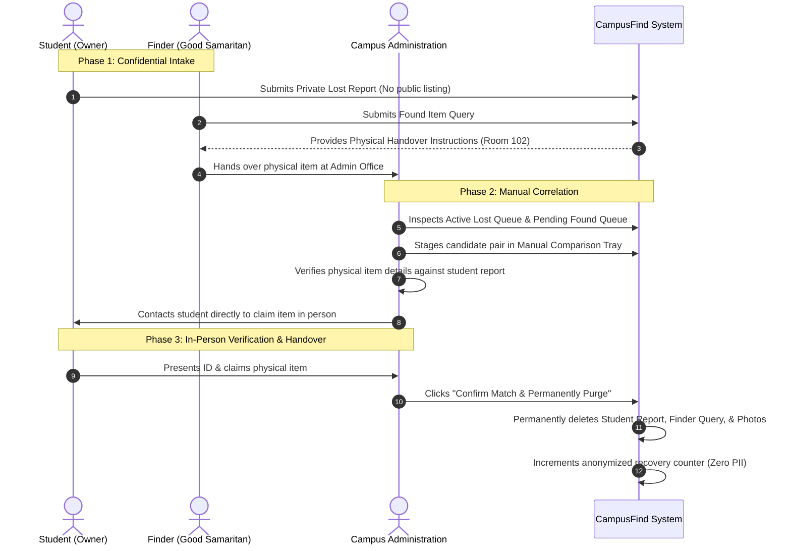

# CampusFind — Comprehensive Project Documentation
*Official Privacy-First Campus Lost & Found Resolution Portal*

---

# SECTION A: NON-TECHNICAL DOCUMENTATION

## 1. Executive Summary & Vision
**CampusFind** is an official university digital service created to solve the persistent issue of lost belongings across university campuses. Unlike informal WhatsApp groups, social media pages, or physical lost-and-found bulletin boards, CampusFind operates under a **Privacy-First, Zero-Public-Listing** operational philosophy.

### Why Traditional Campus Lost & Found Fails:
1. **Public Stalking & Privacy Invasion:** Publicly sharing that a student lost their wallet, ID card, or laptop reveals their name, roll number, routine, and contact info to bad actors.
2. **Fraudulent & Malicious Claims:** Publicly displaying photos of lost items allows fraudulent claimants to describe the item accurately and steal someone else's property.
3. **Extortion & Scams:** Unmoderated direct peer-to-peer chats open students up to reward extortion or harassment.
4. **Data Hoarding:** Old posts remain indexed on search engines forever, long after items have been recovered.

### The CampusFind Solution:
CampusFind bridges students and campus administration through a **confidential submission and human-verified correlation pipeline**. Submissions are never published on an open board. Only authorized campus staff cross-reference lost reports against physical items delivered by Good Samaritans. Once an item is returned, all personal details and reference photos are **permanently purged** from the system.

---

## 2. Core Stakeholders & Personas

| Persona | Role in CampusFind | Key Workflow / Actions | Primary Value Received |
| :--- | :--- | :--- | :--- |
| **The Student (Owner)** | Lost an item on campus | Submits a private lost report with distinctive marks and approximate location. | Peace of mind that their personal data is protected; notified directly by staff when a match arrives. |
| **The Finder (Good Samaritan)** | Discovered an item on campus | Registers the item, receives handover instructions, and brings the item to Room 102. | Clear, safe channel to do the right thing without being harassed by strangers online. |
| **The Administrator (Staff)** | Designated campus officer | Evaluates lost and found records side-by-side, verifies physical custody, contacts owners, and confirms resolution. | Efficient dual-column operations console with live filters, candidate staging tray, and one-click data purging. |

---

## 3. High-Level User Workflows



---

## 4. Key Guarantees & Community Ethics

1. **Zero Public Listings:**
   No student, visitor, or web crawler can browse lost items or view uploaded photos online. All inquiries are strictly private.
2. **Good Samaritan Handover Ethics:**
   Finders hand over physical items directly to university administration (Room 102). No student-to-student transactions, eliminating reward scams and meet-up safety concerns.
3. **Permanent Data Purge:**
   Upon successful item return, both the lost report and found query (along with student phone numbers, roll numbers, and photos) are permanently wiped from the database and disk.
4. **Transparent, Anonymized Audit Records:**
   The university tracks aggregate metrics (e.g., total items resolved) without retaining student names or identifying details.

---

## 5. Frequently Asked Questions (FAQ)

### Q1: Can I browse recently found items online?
**No.** Allowing public browsing leads to fraudulent claims. If you have lost an item, submit a confidential lost report; administrators will cross-reference it against all items physically held in campus custody.

### Q2: What happens if I find an item?
Submit a quick Found Item registration. The confirmation screen provides specific instructions to deliver the item to Room 102 (Campus Administration Office). Staff will log custody and manage verification.

### Q3: Will my phone number or email be shared with the finder?
**Never.** CampusFind does not support direct student-to-student messaging. Only authorized university administrators access contact details, and only to notify you when your item has been found.

### Q4: How do I know my data is really deleted after recovery?
CampusFind enforces database-level hard deletions upon match confirmation. The application removes the operational database records and unlinks the uploaded files from disk, retaining only an anonymized audit counter (timestamp, administrator ID, item category, and days to resolve).

---
---

# SECTION B: TECHNICAL ARCHITECTURE & ENGINEERING SPECIFICATION

## 1. System Architecture Overview

CampusFind is built as a decoupled, full-stack web application designed for high security, zero public exposure, and cross-platform mobile responsiveness.

```
                      +---------------------------------------+
                      |             CLIENT TIER               |
                      |  React 18 + Vite (SPA) on Vercel Edge |
                      +---------------------------------------+
                                          |
                      HTTPS (JSON / Multipart, Strict CORS)
                                          |
                                          v
                      +---------------------------------------+
                      |             API GATEWAY               |
                      |   Cloudflare Edge + Render Container   |
                      |        Express 4 REST Service         |
                      +---------------------------------------+
                             |                     |
                  JWT Bearer Validation       Multer Disk Storage
                             |                     |
                             v                     v
              +-------------------------+   +-------------------+
              |      DATABASE TIER      |   |  STORAGE (Local / |
              |  MongoDB Atlas Cluster  |   |  Render Disk)     |
              | (TLS Replica Set Shards)|   | backend/uploads/  |
              +-------------------------+   +-------------------+
```

### Technology Stack Summary

| Layer | Technology | Primary Role / Justification |
| :--- | :--- | :--- |
| **Frontend Runtime** | React 18.2 (JavaScript / JSX) | Fast Virtual DOM, component state isolation, lightweight lifecycle. |
| **Build Tool & Bundler** | Vite 5.4 | Native ES modules, lightning HMR, optimized production chunks (`gzip < 95 kB`). |
| **Frontend Hosting** | Vercel Edge Network | Global CDN edge caching with SPA rewrites (`vercel.json`). |
| **Backend Runtime** | Node.js (v20+) / Express 4.19 | Non-blocking async event loop, lightweight REST routing. |
| **Backend Hosting** | Render Web Service | Containerized Node environment behind Cloudflare TLS. |
| **Database** | MongoDB Atlas (v7.0+ Replica Set) | Document database with native BSON schemas and transactions. |
| **Authentication** | JWT (jsonwebtoken v9) | Stateless 8-hour cryptographic tokens signed with HMAC-SHA256. |
| **File Handling** | Multer 2.4 | Strict MIME validation, disk streaming, and collision-resistant naming. |
| **Styling & Motion** | Custom CSS3 System | Tailored variables, mobile fluid typography, and `@media (prefers-reduced-motion)`. |

---

## 2. Directory Structure

```
CampusFind/
├── .gitignore                      # Excludes node_modules, .env, .vite, dist, and uploads
├── README.md                       # Project quickstart and architecture notes
├── DOCUMENTATION.md                # Comprehensive technical & non-technical specification
├── backend/
│   ├── .env.example                # Template for environment variables (MONGODB_URI, JWT_SECRET, etc.)
│   ├── index.js                    # Server entry, CORS configuration, DB connection, and routing
│   ├── package.json                # Backend dependencies (express, mongoose, multer, cors, jsonwebtoken)
│   ├── middleware/
│   │   ├── upload.js               # Multer engine with 5MB limit and PNG/JPEG/WebP whitelist
│   │   └── verifyAdminToken.js     # Bearer token verification middleware
│   ├── models/
│   │   ├── LostReport.js           # Schema for confidential student lost reports
│   │   ├── FoundQuery.js           # Schema for found queries from finders
│   │   └── AuditLog.js             # Anonymized zero-PII resolution metrics
│   ├── routes/
│   │   ├── adminRoutes.js          # Admin login, active queues, metrics, and resolve controller
│   │   └── reportRoutes.js         # Public submission endpoints for lost and found reports
│   └── uploads/                    # Local storage directory for item photos (gitignored)
└── frontend/
    ├── index.html                  # HTML5 entry with Plus Jakarta Sans & JetBrains Mono font loading
    ├── vercel.json                 # Vercel SPA rewrite configuration (/(.*) -> /index.html)
    ├── vite.config.js              # Vite configuration with local proxy (/api -> :5000)
    ├── package.json                # Frontend dependencies (react, react-router-dom, axios, lucide-react)
    └── src/
        ├── App.jsx                 # Route definitions and layout structure
        ├── index.css               # Complete design system tokens, utility classes, and media queries
        ├── main.jsx                # React root hydration
        ├── api/
        │   ├── apiClient.js        # Axios instance for public reporting endpoints
        │   └── adminApi.js         # Authenticated Axios instance with JWT interceptors
        ├── components/
        │   ├── Button.jsx          # Accessible button with loading spinner state
        │   ├── ErrorMessage.jsx    # Inline and top-level error callout component
        │   ├── FileUpload.jsx      # Drag-and-drop file upload with thumbnail preview
        │   ├── Footer.jsx          # Site footer with security badges and staff login link
        │   ├── FormField.jsx       # Standard form field with required badges and error hints
        │   ├── FormSectionIndicator.jsx # Visual step progression header for multi-section forms
        │   ├── Header.jsx          # Brand header with geometric logo and privacy pill
        │   ├── LoadingState.jsx    # Accessible loading spinner with screen-reader labels
        │   ├── ProtectedRoute.jsx  # Client-side route guard checking JWT validity
        │   └── WhatHappensNext.jsx # Informational panel explaining next steps after submission
        └── pages/
            ├── LandingPage.jsx     # Hero section, vector illustration, and dual action cards
            ├── LostReportPage.jsx  # Lost item reporting form with section groupings
            ├── FoundQueryPage.jsx  # Found item query form with mandatory photo upload
            ├── SuccessPage.jsx     # Outcome screen with Good Samaritan appreciation callout
            ├── AdminLoginPage.jsx  # Staff login interface with password visibility toggle
            └── AdminDashboardPage.jsx # Operations console with dual queues, filters, and resolution modal
```

---

## 3. Data Models & Schemas

### A. LostReport Model (`backend/models/LostReport.js`)
Captures details submitted by a student who lost an item:

```javascript
const LostReportSchema = new mongoose.Schema({
  studentName: { type: String, required: true, trim: true },
  studentRollNumber: { type: String, required: true, trim: true },
  studentEmail: { type: String, required: true, trim: true, lowercase: true },
  studentPhone: { type: String, required: true, trim: true },
  itemName: { type: String, required: true, trim: true },
  itemCategory: { 
    type: String, 
    required: true,
    enum: [
      'Electronics', 'Documents/ID Cards', 'Keys', 'Bags & Wallets',
      'Clothing & Apparel', 'Books & Stationery', 'Accessories & Jewellery', 'Other'
    ]
  },
  itemCharacteristics: { type: String, required: true, trim: true },
  approxLostTime: { type: Date, required: true },
  approxLostLocation: { type: String, required: true, trim: true },
  itemImage: { type: String, default: null }, // Filename on disk
  status: { type: String, enum: ['active', 'resolved'], default: 'active' },
  createdAt: { type: Date, default: Date.now }
});
```

### B. FoundQuery Model (`backend/models/FoundQuery.js`)
Captures details submitted by a finder:

```javascript
const FoundQuerySchema = new mongoose.Schema({
  name: { type: String, required: true, trim: true },
  rollNumber: { type: String, required: true, trim: true },
  email: { type: String, required: true, trim: true, lowercase: true },
  phone: { type: String, required: true, trim: true },
  itemName: { type: String, required: true, trim: true },
  category: { 
    type: String, 
    required: true,
    enum: [
      'Electronics', 'Documents/ID Cards', 'Keys', 'Bags & Wallets',
      'Clothing & Apparel', 'Books & Stationery', 'Accessories & Jewellery', 'Other'
    ]
  },
  characteristics: { type: String, required: true, trim: true },
  location: { type: String, required: true, trim: true },
  itemImage: { type: String, required: true }, // Mandatory photo of the physical found item
  locationImage: { type: String, default: null }, // Optional location reference
  status: { type: String, enum: ['pending', 'resolved'], default: 'pending' },
  createdAt: { type: Date, default: Date.now }
});
```

### C. AuditLog Model (`backend/models/AuditLog.js`)
*Crucial Privacy Rule:* Retains zero PII to maintain immutable reporting metrics without violating user privacy:

```javascript
const AuditLogSchema = new mongoose.Schema({
  timestamp: { type: Date, default: Date.now },
  adminId: { type: String, required: true },
  resolvedCategory: { type: String, required: true },
  timeToResolveDays: { type: Number, required: true }
});
```

---

## 4. API Endpoints Specification

### Public Reporting Routes (`/api/reports`)

#### 1. Submit Lost Report
- **Endpoint:** `POST /api/reports/lost`
- **Content-Type:** `multipart/form-data`
- **Fields:** `studentName`, `studentRollNumber`, `studentEmail`, `studentPhone`, `itemName`, `itemCategory`, `itemCharacteristics`, `approxLostTime`, `approxLostLocation`, optional `itemImage` (binary).
- **Validation:** 
  - All text fields required.
  - Email verified with standard regex.
  - Image MIME must be `image/png`, `image/jpeg`, or `image/webp`. File size $\le 5\text{MB}$.
- **Success Response:**
  ```json
  HTTP 201 Created
  {
    "status": "success",
    "message": "Your report has been successfully received.",
    "reportId": "6acfbcbb278d1b37e3c6c98d"
  }
  ```

#### 2. Submit Found Query
- **Endpoint:** `POST /api/reports/found`
- **Content-Type:** `multipart/form-data`
- **Fields:** `name`, `rollNumber`, `email`, `phone`, `itemName`, `category`, `characteristics`, `location`, mandatory `itemImage` (binary), optional `locationImage` (binary).
- **Success Response:**
  ```json
  HTTP 201 Created
  {
    "status": "success",
    "message": "Query submitted. Please hand over the physical item to administration.",
    "queryId": "6acfbcf6278d1b37e3c6c98f"
  }
  ```

---

### Protected Administrative Routes (`/api/admin`)
*All administrative endpoints require the `Authorization: Bearer <JWT_TOKEN>` header.*

#### 3. Admin Authentication
- **Endpoint:** `POST /api/admin/login`
- **Payload:** `{ "username": "admin", "password": "<password>" }`
- **Success Response:**
  ```json
  HTTP 200 OK
  {
    "status": "success",
    "token": "eyJhbGciOiJIUzI1NiIsInR5cCI6IkpXVCJ9..."
  }
  ```

#### 4. Fetch Active Lost Reports
- **Endpoint:** `GET /api/admin/lost-reports`
- **Headers:** `Authorization: Bearer <TOKEN>`
- **Behavior:** Queries `LostReport.find({ status: 'active' }).sort({ createdAt: -1 })`.
- **Response:**
  ```json
  HTTP 200 OK
  {
    "status": "success",
    "count": 1,
    "data": [ ... ]
  }
  ```

#### 5. Fetch Pending Found Queries
- **Endpoint:** `GET /api/admin/found-queries`
- **Headers:** `Authorization: Bearer <TOKEN>`
- **Behavior:** Queries `FoundQuery.find({ status: 'pending' }).sort({ createdAt: -1 })`.

#### 6. Fetch Resolution Metrics
- **Endpoint:** `GET /api/admin/metrics`
- **Headers:** `Authorization: Bearer <TOKEN>`
- **Behavior:** Queries `AuditLog.countDocuments()`.
- **Response:**
  ```json
  HTTP 200 OK
  {
    "status": "success",
    "totalResolutions": 14
  }
  ```

#### 7. Execute Match Resolution & Data Purge
- **Endpoint:** `POST /api/admin/resolve`
- **Headers:** `Authorization: Bearer <TOKEN>`, `Content-Type: application/json`
- **Payload:**
  ```json
  {
    "lostReportId": "6acfbcbb278d1b37e3c6c98d",
    "foundQueryId": "6acfbcf6278d1b37e3c6c98f",
    "resolvedCategory": "Electronics"
  }
  ```
- **Controller Execution Pipeline:**
  1. Validates that both ObjectIDs are valid and that both documents exist in MongoDB.
  2. Permanently removes both documents via `LostReport.findByIdAndDelete(lostReportId)` and `FoundQuery.findByIdAndDelete(foundQueryId)`.
  3. Purges associated image files from server storage using `fs.unlinkSync()`.
  4. Calculates duration: `Math.max(0, Math.round((Date.now() - lostReport.createdAt) / (1000 * 60 * 60 * 24)))`.
  5. Inserts an anonymized `AuditLog` record containing `timestamp`, `adminId`, `resolvedCategory`, and `timeToResolveDays`.
- **Response:**
  ```json
  HTTP 200 OK
  {
    "status": "success",
    "message": "Match confirmed. Sensitive data purged. Audit log created."
  }
  ```

---

## 5. Security & Privacy Architecture

```
[ Incoming Browser / Client Request ]
                 |
                 v
      [ CORS Whitelist Check ]
       - Allowed: vercel.app, localhost:3000, 5173
       - Origin not in list? -> Reject without allow-headers
                 |
                 v
      [ Route Classification ]
        /api/reports/*  ---> Public Report Ingestion
        /api/admin/*    ---> [ JWT Authentication Middleware ]
                                 - Verify Bearer token signature
                                 - Check token expiration (8h max)
                                 - Invalid? -> HTTP 401 Unauthorized
                 |
                 v
      [ Sensitive Media Isolation ]
        - Direct HTTP GET to /uploads/* yields HTTP 404
        - Photos only referenced privately by authorized admin session
```

1. **Origin Access Restriction (CORS):**
   Backend CORS is restricted to `https://campusfind-frontend-one.vercel.app` and verified localhost developer ports (`:3000`, `:5173`). Unapproved third-party websites receive clean rejections without `Access-Control-Allow-Origin` headers.
2. **Stateless JWT Guarding:**
   Admin endpoints are protected by `verifyAdminToken.js`, which checks the Bearer header format and verifies signatures using the 256-bit `JWT_SECRET`. Tokens expire automatically after 8 hours.
3. **Private File System:**
   Express does **not** expose an open `express.static('uploads')` route. Direct browser requests to `/uploads/<filename>` return `HTTP 404`. Uploaded files are only referenced within authenticated administrative comparisons.
4. **Resilient File Deletion (`safeUnlink`):**
   During resolution or validation failures, file deletions verify `fs.existsSync()` to prevent unhandled node exceptions or race conditions.

---

## 6. Frontend Architecture & Design System

The frontend is designed around usability principles from **Nielsen Norman Group (NN/g)**, **Apple Human Interface Guidelines (HIG)**, and **GOV.UK design patterns**:

- **Visual Palette:**
  - Anchor: Midnight Navy (`#0f172a`) and Slate (`#1e293b`).
  - Action Primary: Electric Indigo (`#4f46e5` hover `#4338ca`).
  - Trust & Verification: Cyan (`#0891b2`) and Mint (`#059669`).
  - Status Warning: Restrained Amber (`#d97706`).
  - Destructive Purge: Crimson (`#dc2626`).
- **Typography:**
  Loaded via Google Fonts in `index.html`: **Plus Jakarta Sans** (headings and UI controls) and **JetBrains Mono** (status badges, record IDs, and metrics).
- **Accessibility & Touch Ergonomics:**
  - Minimum touch targets of $\ge 44\text{px}$ across all primary buttons.
  - Explicit `<label>` elements linked via `htmlFor` with visible required asterisks and `aria-describedby` hints.
  - Dedicated **Error Summary Box** at form tops with anchor links focusing directly on invalid fields.
  - Full support for `@media (prefers-reduced-motion: reduce)`, disabling CSS keyframes and transitions for users with motion sensitivity.
- **Client-Side Routing & SPA Rewrites:**
  Configured in `frontend/vercel.json` with a universal rewrite rule (`/(.*) -> /index.html`), preventing HTTP 404 errors when students or administrators reload deep routes.

---

## 7. Deployment & Infrastructure Topology

```
+-------------------------------------------------------------------------------+
| FRONTEND DEPLOYMENT (Vercel)                                                  |
| - Root Directory: frontend/                                                   |
| - Build Command: vite build                                                   |
| - Output Directory: dist                                                      |
| - Routing: vercel.json rewrite (/(.*) -> /index.html)                         |
| - Environment Variables:                                                      |
|     VITE_API_URL = https://campusfind-hs26.onrender.com                       |
+-------------------------------------------------------------------------------+
                                      |
                           HTTPS REST API Requests
                                      |
+-------------------------------------------------------------------------------+
| BACKEND DEPLOYMENT (Render)                                                   |
| - Root Directory: backend/                                                    |
| - Build Command: npm install                                                  |
| - Start Command: node index.js                                                |
| - Environment Variables:                                                      |
|     PORT = 5000                                                               |
|     MONGODB_URI = mongodb://<user>:<pwd>@...buabol2.mongodb.net/campusfind   |
|     JWT_SECRET = <64_character_hex_secret>                                    |
|     ADMIN_USERNAME = admin                                                    |
|     ADMIN_PASSWORD = <secure_admin_password>                                  |
|     UPLOAD_DIR = /var/data/uploads (Optional: Render Persistent Disk)         |
+-------------------------------------------------------------------------------+
                                      |
                         Encrypted TLS Connection
                                      |
+-------------------------------------------------------------------------------+
| DATABASE DEPLOYMENT (MongoDB Atlas)                                           |
| - Cluster: Cluster0 (Replica Set: atlas-1bvvpo-shard-0)                       |
| - Database: campusfind                                                        |
| - Collections: lostreports, foundqueries, auditlogs                           |
+-------------------------------------------------------------------------------+
```

---

## 8. Maintenance & Operational Runbook

### Local Development Setup
1. **Clone & Install:**
   ```bash
   git clone https://github.com/sujith0718-coder/CampusFind.git
   cd CampusFind
   cd backend && npm install
   cd ../frontend && npm install
   ```
2. **Environment Configuration:**
   - Create `backend/.env` based on `backend/.env.example`.
   - Create `frontend/.env.local` containing `VITE_API_URL=http://localhost:5000` (or leave empty to use local Vite proxy).
3. **Run Services:**
   ```bash
   # Terminal 1: Backend API
   cd backend && npm run start

   # Terminal 2: Frontend Client
   cd frontend && npm run dev
   ```
   Open `http://localhost:3000` in your browser.

### Running Regression Test Suites
From the `backend/` directory:
```bash
# Public reporting validation suite (9 tests)
node ../.gemini/antigravity-ide/brain/1998e099-f329-46f3-a458-a6366e05bc89/scratch/test_phase2_reports.js

# Admin authentication & resolution suite (8 tests)
node ../.gemini/antigravity-ide/brain/1998e099-f329-46f3-a458-a6366e05bc89/scratch/test_phase3_admin.js
```

### Production Build Validation
From the `frontend/` directory:
```bash
npm run build
```
Build output must compile with zero errors into `frontend/dist/`.
